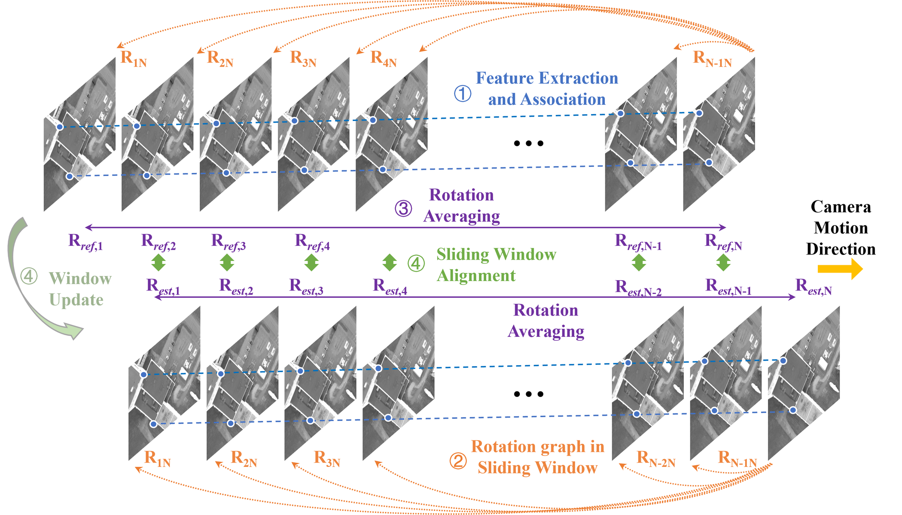
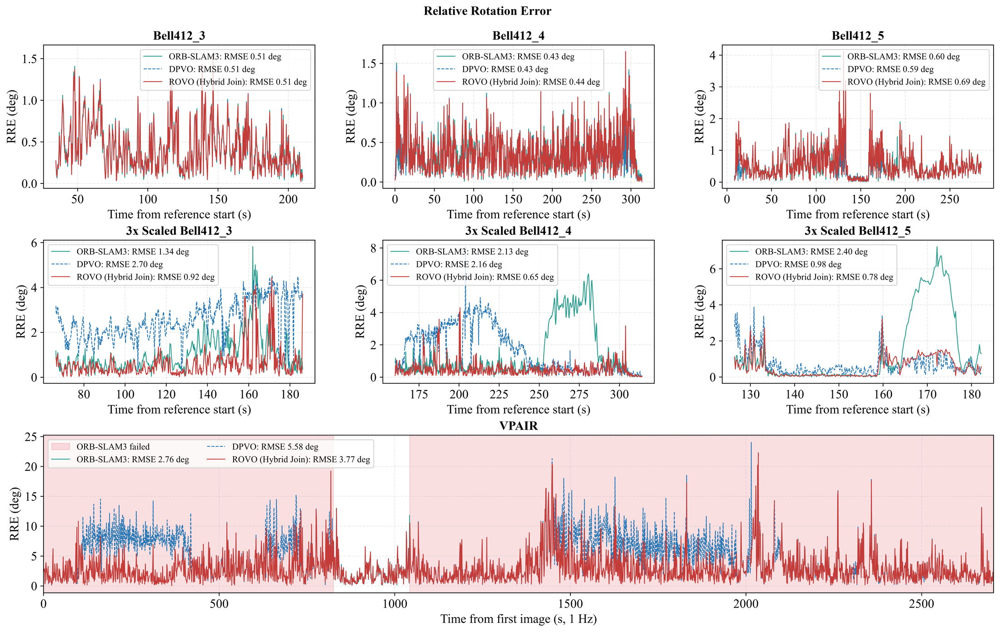

# ROVO: Robust Rotation-Only Visual Odometry for UAVs at Low and Moderate Altitudes

Xiaokai Song, Li Zhang, Xichao Teng, Erting Pan, Yibin Ye, Kun Wang, Leqi Liu, and Guangcheng Dai

**The full source code will be released after the paper is accepted.** This repository currently provides the flight experiment trajectories and the Python scripts used to evaluate them.

## Method

ROVO estimates a trajectory of camera orientations from calibrated monocular aerial imagery. It associates features between an incoming image and buffered keyframes. A five-point rotation and an eigensolver refinement provide candidate measurements for each matched pair. Geometric verification and agreement across historical views determine which relative rotations enter the graph. Robust rotation averaging estimates orientations in each sliding window, and shared frames align overlapping windows before fusion. The trajectory state carries only orientation.



*ROVO framework from Figure 2 of the manuscript.*

## Flight experiments

The benchmark covers MUN-FRL Bell412 flights 3, 4, and 5 at the original focal length and after reprojection to three times the focal length, plus the 2,706 released VPAIR query images. We compare ROVO with ORB-SLAM3 and DPVO and provide trajectories for four ROVO ablation variants. [Flight metrics](results/flight_metrics.csv) ? [Ablation metrics](results/ablation_metrics.csv)



*The Bell412 panels use frame pairs shared by all three methods. The VPAIR panel uses each method?s valid adjacent query pairs. Shading indicates missing ORB-SLAM3 poses.*

On VPAIR, ROVO estimated 2,681 of 2,706 orientations (99.1% coverage) and achieved 2.631? RMSE on the 216 adjacent pairs shared by all three methods. The released Bell412-5 triple-focal-length Hybrid Join rerun yields 0.780? on the shared comparison pairs. The manuscript?s main comparison table reports 0.789? for this condition.

## Reproduce the evaluation

Install the Python dependencies and run both evaluations from the repository root.

```sh
python -m pip install numpy scipy matplotlib
python results/compare.py --no-show
python results/compare.py --no-show --ablation
```

Each command writes `metrics.csv` and `comparison_rre.png` under `results/rotation_evaluation/`. The bundled trajectories and orientation references are sufficient to run both commands. [Evaluation protocol and data sources](results/README_compare.md)
